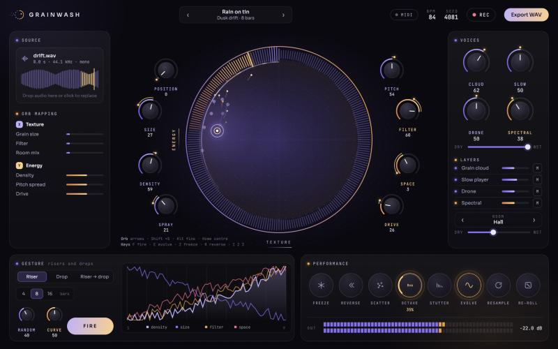

# Grainwash



**[Try it here](https://davidnb3.github.io/grainwash/)**

You give it a sound. It chops it into hundreds of tiny pieces and plays them back all at once, slowly drifting somewhere else. Voice memo, field recording, a kick drum, whatever. It usually ends up as a weird cloud of its former self.

Drag the orb around and several knobs move together. There's a riser/drop button for when you want drama.

It runs in your browser and your files never leave it. REC saves a WAV.

Best in Chrome or Edge (MIDI only works there). Headphones help.

To run it yourself:

```bash
npm install
npm run dev
```
